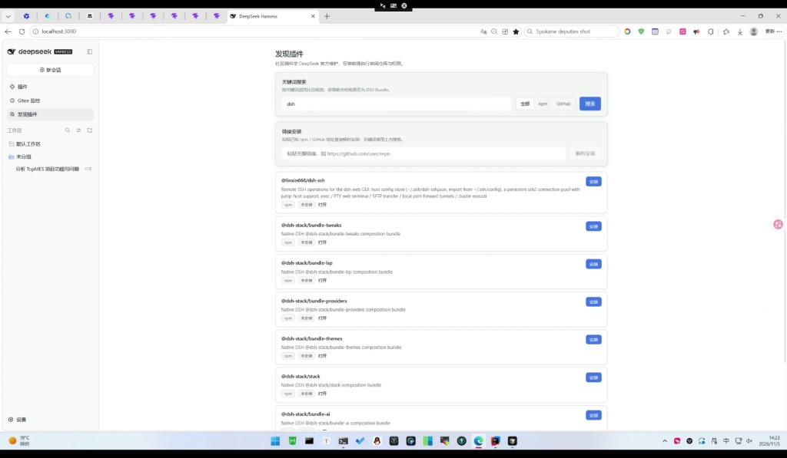
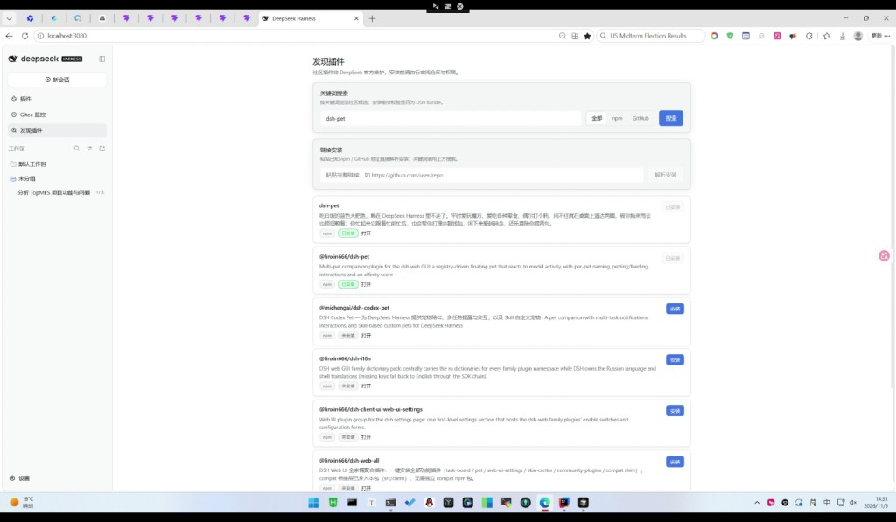
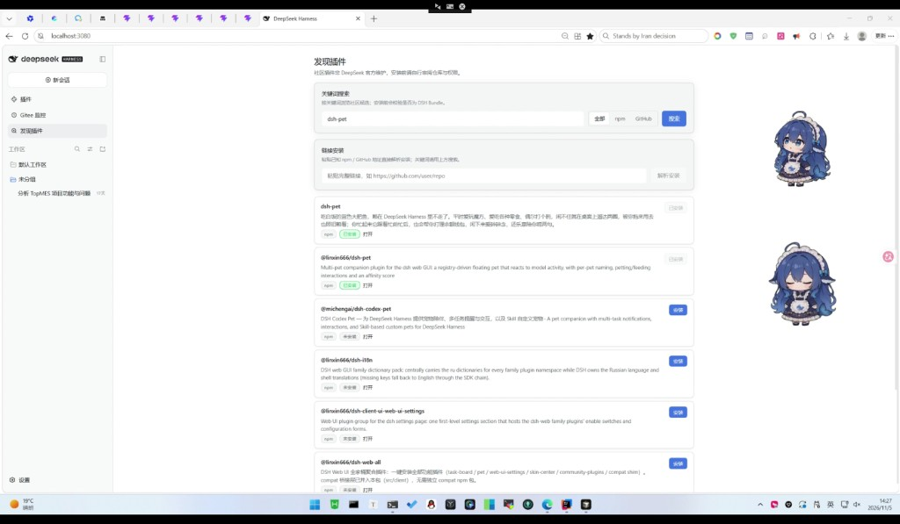

# dsh-plugin-discovery

在 [DeepSeek Harness](https://github.com/deepseek-ai)（DSH）里发现并安装社区 Bundle 插件。

侧栏新增「发现插件」面板：可按关键词搜索 GitHub / npm 上的社区插件，也可粘贴已知仓库链接解析安装。安装前会走 `pluginManager.inspect`，确认是合法 DSH Bundle 后再安装。



## 功能

- 个性化推荐：根据已安装插件偏好，从精选目录排序推荐
- 分类浏览：桌宠 / 主题 / IM / 记忆 / 效率 / 多媒体 / 远程 / 市场 / 多智能体
- 远程目录自动更新：优先拉取 Gitee raw JSON，失败再试 GitHub；按 `version` 升级，缓存到 `$DSH_HOME/cache/...`；离线回退包内 JSON
- 内置 `data/recommended.json`（随包分发作兜底）
- 关键词搜索（全部 / npm / GitHub）
- 链接解析安装（npm / GitHub URL）
- 安装状态：未安装 / 安装中 / 已安装（支持刷新后继续跟踪）
- 安装前 Bundle 校验，降低装错包的风险
- 中英文界面





## 安装

在 DSH 的「插件」页安装以下任一形式。

### 国内推荐

npm 包名（多数环境已使用 npmmirror / 淘宝镜像）：

```text
dsh-plugin-discovery
```

GitHub 访问慢时，优先用 Gitee：

```text
https://gitee.com/hjhcos/dsh-plugin-discovery
```

```text
git+https://gitee.com/hjhcos/dsh-plugin-discovery.git
```

### 备用

```text
npm:dsh-plugin-discovery
```

```text
github:hjhcos/dsh-plugin-discovery
```

安装并启用后，刷新 Web UI，侧栏会出现「发现插件」。

> 社区插件非 DeepSeek 官方维护，安装前请自行审阅仓库与权限。

## 使用

1. 打开侧栏「发现插件」
2. 默认进入「为你推荐」；也可切到「分类浏览」或「在线搜索」
3. 点击「安装」，等待状态变为「已安装」
4. 到「插件」页确认启用情况

精选目录维护在 [`data/recommended.json`](data/recommended.json)。日常只需更新该文件并推到 Gitee/GitHub，用户端会按版本自动拉取，无需重装插件。

默认远程地址（可在插件配置里改）：

- Gitee：`https://gitee.com/hjhcos/dsh-plugin-discovery/raw/main/data/recommended.json`
- GitHub：`https://raw.githubusercontent.com/hjhcos/dsh-plugin-discovery/main/data/recommended.json`

可选：在插件配置中填写 GitHub Token，可提高 GitHub 搜索配额。

## 开发

```bash
# 本地以 file: 方式挂到 profile
# package.json dependencies:
#   "dsh-plugin-discovery": "file:../../../bundles/dsh-plugin-discovery"
```

## 仓库镜像

- GitHub：https://github.com/hjhcos/dsh-plugin-discovery
- Gitee：https://gitee.com/hjhcos/dsh-plugin-discovery
- npm：https://www.npmjs.com/package/dsh-plugin-discovery

## License

[MIT](./LICENSE) © hjhcos
