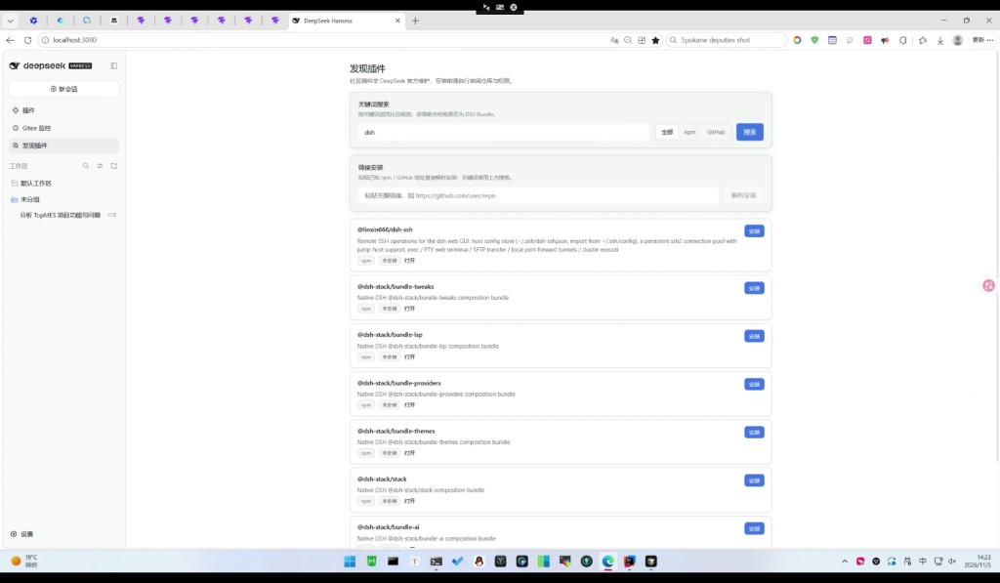
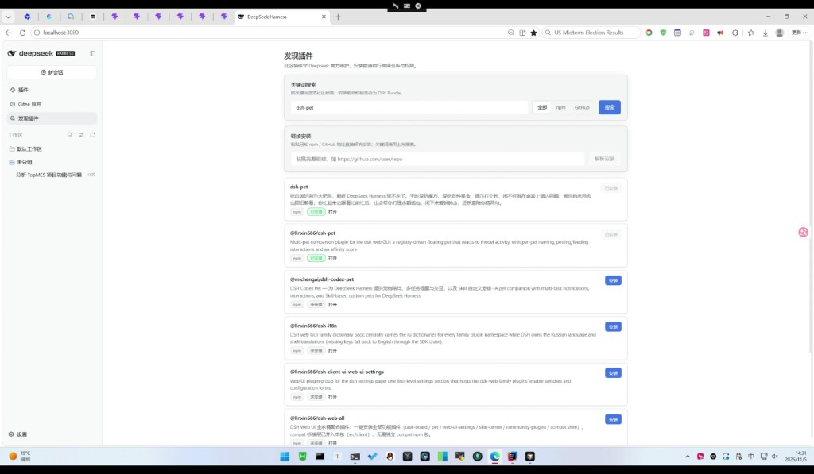

# 给 DeepSeek Harness 加一个「应用商店」：开源插件 dsh-plugin-discovery

> 作者：hjhcos  
> 开源协议：MIT  
> npm：`dsh-plugin-discovery`  
> GitHub：https://github.com/hjhcos/dsh-plugin-discovery  
> Gitee：https://gitee.com/hjhcos/dsh-plugin-discovery

## 写在前面

DeepSeek Harness（DSH）本身能力很强，但社区 Bundle 分散在 GitHub、npm 各处，新人常常不知道去哪找、怎么装才安全。

我做了一个侧栏插件：**发现插件（dsh-plugin-discovery）**——把「搜索 → 校验 → 安装」收进 DSH Web UI，让社区插件发现体验更接近应用商店。

## 它能做什么

- 关键词搜索（全部 / npm / GitHub）
- 粘贴完整链接直接解析安装
- 安装前用官方 `pluginManager.inspect` 校验是否为合法 DSH Bundle
- 安装状态三态：未安装 / 安装中 / 已安装（刷新后也能继续跟踪）

界面示意：





## 一分钟安装

打开 DSH →「插件」页，在安装输入框填下面任一方式，安装并启用后刷新 Web，侧栏会出现「发现插件」。

### 国内推荐（优先）

1. **npm 包名（最省事）**——多数国内环境已配淘宝 / npmmirror 镜像，直接装：

```text
dsh-plugin-discovery
```

若刚发布不久镜像尚未同步，可稍等几分钟，或临时切官方源后再装。

2. **Gitee 仓库（GitHub 访问慢时首选）**——粘贴完整地址即可：

```text
https://gitee.com/hjhcos/dsh-plugin-discovery
```

也可写成：

```text
git+https://gitee.com/hjhcos/dsh-plugin-discovery.git
```

### 国际 / 备用

```text
github:hjhcos/dsh-plugin-discovery
```

或 npm 官方页：https://www.npmjs.com/package/dsh-plugin-discovery

### 国内安装小提示

- 网络不稳定时优先 **Gitee 链接**，不要死磕 GitHub。
- 装完若侧栏没有「发现插件」：到「插件」页确认已启用，再强制刷新浏览器。
- 本插件搜索社区包仍会访问 GitHub / npm；仅「装本插件本身」建议走国内通道。

## 使用建议

1. 先搜关键词（例如 `dsh-pet`），不要拿「解析安装」当搜索框。
2. 安装前打开仓库链接看一眼权限与维护情况——社区插件非官方维护。
3. 装完到「插件」页确认是否启用成功。

## 为什么开源

希望降低社区 Bundle 的分发门槛：作者把插件发到 npm / GitHub 后，用户可以在发现页搜到并一键安装。

欢迎 Star、提 Issue / PR：

- GitHub：https://github.com/hjhcos/dsh-plugin-discovery
- Gitee：https://gitee.com/hjhcos/dsh-plugin-discovery

MIT 协议，欢迎二次分发与改进。
