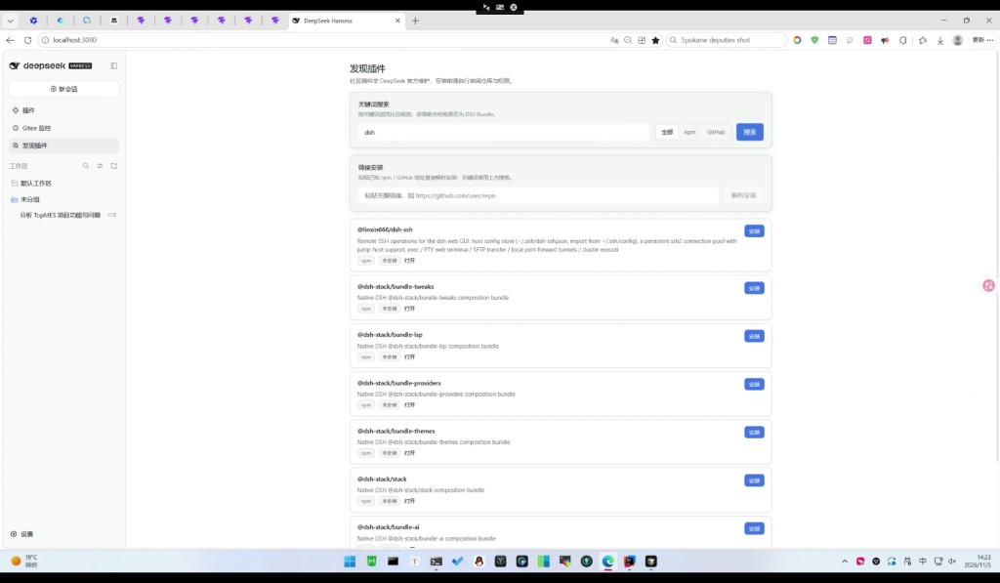
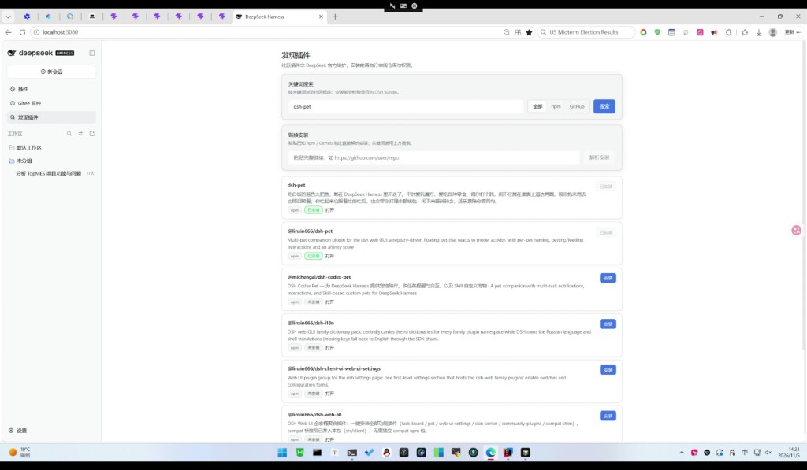
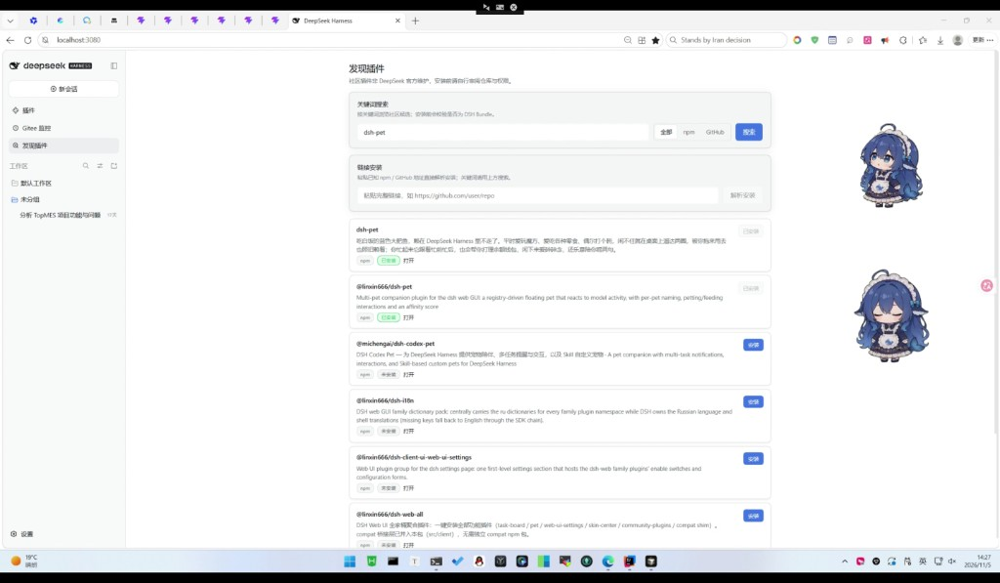

# 开源一个 DSH 插件发现器：在 DeepSeek Harness 里搜装社区 Bundle

大家好，我是 hjhcos。

最近在用 DeepSeek Harness（DSH）时，最大的痛点不是「不会装插件」，而是**不知道社区里有哪些 Bundle、装之前安不安全**。于是做了这个开源插件：

**`dsh-plugin-discovery`（发现插件）**

## 一句话介绍

给 DSH Web 加一个侧栏「发现插件」面板：搜 GitHub / npm → inspect 校验 → 一键安装。

## 截图

关键词搜索与列表：



安装状态（未安装 / 已安装）：



装完后的效果示例：



## 核心设计

1. **只装合法 Bundle**：安装前走 `pluginManager.inspect`，不是 DSH Bundle 直接拒绝。
2. **安装态可观察**：未安装 / 安装中 / 已安装；刷新页面也能用 `requestId` 继续跟踪。
3. **精确匹配包名**：避免 `dsh-pet` 与 `@scope/dsh-pet` 这类短名串线。

## 安装（含国内方式）

打开 DSH「插件」页，任选一种安装源：

**国内推荐 ① npm 包名**（走淘宝 / npmmirror 镜像即可）：

```text
dsh-plugin-discovery
```

**国内推荐 ② Gitee**（GitHub 慢或不稳定时用）：

```text
https://gitee.com/hjhcos/dsh-plugin-discovery
```

```text
git+https://gitee.com/hjhcos/dsh-plugin-discovery.git
```

**备用 GitHub：**

```text
github:hjhcos/dsh-plugin-discovery
```

装完启用 → 刷新页面 → 侧栏出现「发现插件」。镜像若暂时搜不到包，等同步或改用 Gitee 链接。

## 链接

- npm：https://www.npmjs.com/package/dsh-plugin-discovery
- GitHub：https://github.com/hjhcos/dsh-plugin-discovery
- Gitee：https://gitee.com/hjhcos/dsh-plugin-discovery
- License：MIT

如果对你有用，欢迎 Star；有问题直接开 Issue。也欢迎社区插件作者把自己的 Bundle 发到 npm/GitHub，方便被发现页检索到。
