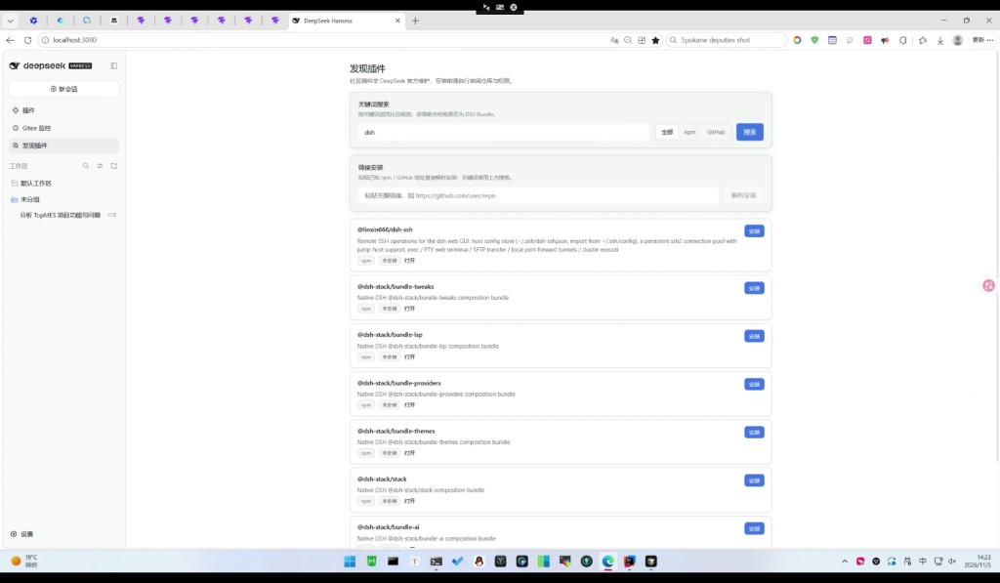
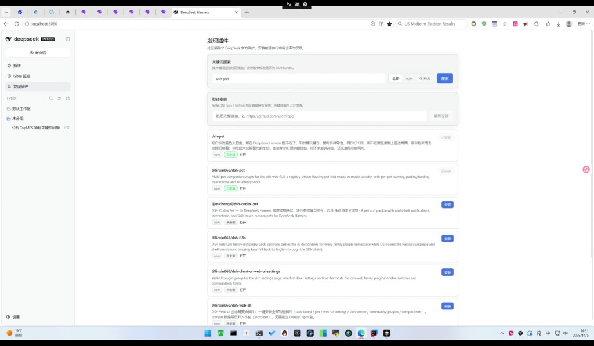
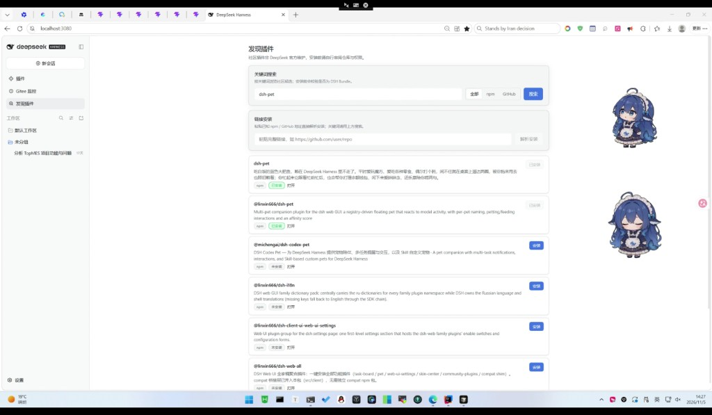

# 我给 DeepSeek Harness 做了个「插件发现页」，开源了

DeepSeek Harness（DSH）的插件生态在长，但入口偏「你得先知道包名」。普通人想找桌宠、主题、小工具，往往只能去 GitHub / npm 裸搜，再手动安装，体验割裂，也容易装错。

所以我写了一个开源 Bundle：

**dsh-plugin-discovery（发现插件）**

目标很简单：在 DSH 侧栏里完成「发现 → 校验 → 安装」。

## 长什么样

搜索与候选列表：

状态标记：

安装完成后的界面示例：

## 它解决什么问题

- 不知道社区有哪些插件：关键词搜索 GitHub / npm
- 怕装到非 Bundle 包：安装前 inspect
- 安装过程不透明：未安装 / 安装中 / 已安装三态
- 刷新后不知道装没装完：用 requestId 继续跟踪

## 怎么装

在 DSH 插件页输入：

`dsh-plugin-discovery`

或：

`github:hjhcos/dsh-plugin-discovery`

装好启用，刷新 Web，侧栏就能看到「发现插件」。

## 开源地址

- GitHub：https://github.com/hjhcos/dsh-plugin-discovery
- Gitee：https://gitee.com/hjhcos/dsh-plugin-discovery
- npm：https://www.npmjs.com/package/dsh-plugin-discovery

协议 MIT，作者 hjhcos。欢迎试用、提建议，也欢迎插件作者把 Bundle 规范发布，让更多人能搜到你的作品。
